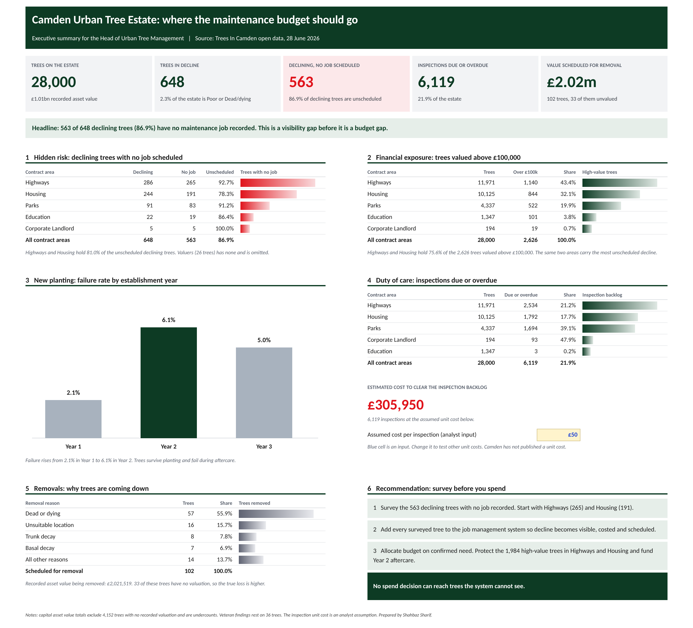

# Camden Urban Tree Estate: Where the Maintenance Budget Should Go

An Excel analysis and stakeholder deck for Camden's Head of Urban Tree Management, built on 28,000 council tree records.

## Results

- 563 of 648 declining trees (86.9%) have no maintenance job recorded. The council has a visibility gap before it has a budget gap.
- Highways and Housing hold 81.0% of those unscheduled trees and 75.6% of the trees valued above £100,000.
- New trees fail most in their second year (6.1%, against 2.1% in Year 1), which points to aftercare rather than planting.



## The business problem

The maintenance budget is fixed and split across six contract areas. Without a view of where trees are declining, where inspections are slipping and where the high-value trees sit, spend follows area size or last year's split instead of risk.

## Data

[Trees In Camden](https://data.gov.uk/dataset/trees-in-camden), Camden Council open data, extract dated 28 June 2026. 28,000 records (27,992 unique trees), 47 fields, six contract areas, £1.01bn of recorded asset value.

## Approach

1. Audited all 47 fields for completeness before any analysis and logged every gap.
2. Converted the asset value field from text to numbers and built flags for hidden risk, inspection status, planting failure and high-value trees.
3. Answered ten business questions with pivot tables, each with a written finding.
4. Built a one-page executive summary on live formulas, with the inspection unit cost as an adjustable input.
5. Wrote a stakeholder deck that takes the findings to a decision.

## Findings

| Contract area | Declining | No job recorded | Trees over £100k | Overdue inspections |
|---|---|---|---|---|
| Highways | 286 | 265 | 1,140 | 9 |
| Housing | 244 | 191 | 844 | 465 |
| Parks | 91 | 83 | 522 | 8 |
| Education | 22 | 19 | 101 | 3 |
| Corporate Landlord | 5 | 5 | 19 | 2 |
| Valuers | 0 | 0 | 0 | 3 |
| All areas | 648 | 563 | 2,626 | 490 |

The same two areas, Highways and Housing, carry most of the unscheduled decline and most of the high-value stock.

Inspections are a Housing problem. 6,119 trees are due for inspection this financial year or overdue, but only 490 are overdue, and 465 of those are in Housing.

102 trees are scheduled for removal, carrying £2.02m of recorded asset value. 56% are coming down because they are dead or dying. 33 of the 102 have no valuation, so the real loss is higher.

## Recommendations

1. Survey the 563 declining trees with no job recorded, starting with Highways (265) and Housing (191).
2. Log every surveyed tree in the job management system so decline becomes visible, costed and scheduled.
3. Clear the 490 overdue inspections, starting with the 465 in Housing.
4. Allocate budget on confirmed need. Protect the 1,984 high-value trees in Highways and Housing, and fund Year 2 aftercare.

## Limitations

- 4,152 trees have no recorded asset value, so every £ figure is an undercount.
- Condition rates exclude 414 records with no condition recorded.
- Planting failure rates rest on small counts: 14, 42 and 30 failed trees across Years 1 to 3.
- 8 tree IDs appear twice. They are kept because they do not change any reported figure.

## Stakeholder deck

The deck is written for the Head of Urban Tree Management. Every slide title states its finding, so the argument reads from the titles alone, and the recommendation comes before the detail.

[Download the deck (PowerPoint)](Camden_deck.pptx)

## Files

```
Camden_Tree_Analysis.xlsx   Workbook: executive summary, analyst dashboard, ten business questions, species analysis, data audit, raw data
Camden_deck.pptx            Stakeholder deck
executive_summary.png       One-page summary
```

Open the workbook in Excel. Every figure recalculates from the raw data tab.

Built with Excel (pivot tables, COUNTIFS, structured tables) and Google Slides.

Shahbaz Sharif, Data Analyst | [Portfolio](https://shahbazsharif1.github.io/shahbaz-portfolio/) | [LinkedIn](https://www.linkedin.com/in/shahbaz-sharif/)
